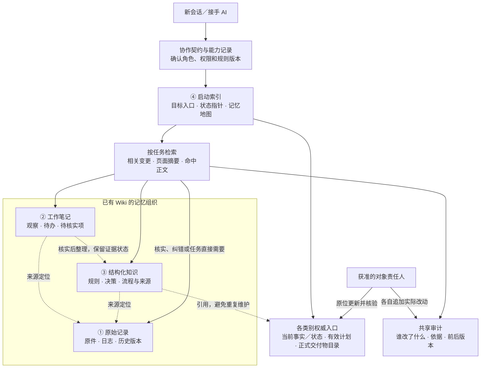
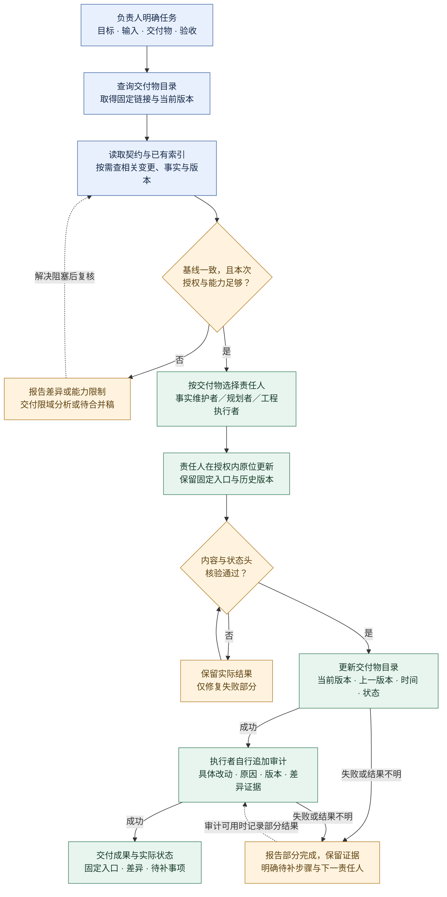

生效｜v1.2.0｜2026-11-24T10:58:17+08:00｜moronfranklyn-lab｜基于 v1.1.1｜仓库所有者授权更新协作架构

# 多 AI 协作工作法

把多个 AI 的工作接起来：共享依据、明确谁负责哪份交付物、从固定入口读取当前版本，执行者各自记录具体改动。

适合个人或小团队同时使用多个 AI 客户端、CLI 或 Agent 的项目。可以搭配飞书、Notion、Git 仓库或其他共享存储；无需先搭建自动路由系统。

这个仓库提供方法、可安装的 Skill 和可填写模板。它不会自动接通模型、创建云端表格、配置权限或建立后台同步。采用前需要按自己的工具和任务做能力测试。

## 协作架构：四层记忆与权威入口

把“资料怎么组织”与“谁在哪里维护”分开。四层帮助新会话定位上下文；事实、计划、交付物仍按类别指定权威入口，不因复制到索引就变成新版本。



**四层不是四级可信度。** 原始转写也可能错，结构化知识也可能有待确认项；证据状态与来源始终保留。启动索引只负责定位，回答当前状态仍需核实权威记录。足够完成任务即停止读取，避免递归通读全库。

先用一页、约 80 行试行索引预算，再按实际上下文调整；这不保证总 token 或费用封顶。索引是否自动加载取决于客户端配置。只有在获得整理指令或已有相应授权时才整理，不会自行启动每周任务。

详见 [分层记忆与检索](references/memory.md)，可从 [启动索引模板](templates/startup-index.md) 开始。四层适用于长期项目；一次小任务沿用已有入口即可。

## 方法论流程图

已有协作入口后，日常任务按下面的流程执行。角色按本次交付物选择，不要求每个任务都调用多个 AI；首次接入或能力变化时，再验证所需权限与工具能力。



**目录负责“当前在哪里、是什么版本”，台账负责“谁改了什么、为什么”。** 各 AI 直接记录自己实际执行的操作，无须让另一个 AI 重读后代记。目录更新失败时也要尝试记录部分成功；恢复后先检查是否已有更新，只补缺失步骤，不重复已成功的正文修改。共享可见不代表其他 AI 已经读取。

## 一分钟开始

1. 沿用或指定业务事实入口、正式交付物目录和协作变更台账；三者分工明确，不复制正文。
2. 按交付物指定责任人：规划、工程等各自维护获准成果，事实维护者维护业务口径，可以一人兼任。
3. 每个实际实例测试所需能力。读取正式成果先查目录，再打开固定链接，核对状态头与版本。
4. 长期项目增加一页启动索引，链接当前状态与各层入口；按任务读摘要和正文，不重复维护进度。
5. 跑通一个小任务：原位更新 → 核验 → 同步目录 → 执行者自己追加具体差异。无须再找另一个 AI 重读后代记。

一次小任务只需要目标、输入、交付物和验收。完整模板用于跨工具、有状态修改、多人交接或反复执行的工作，不要求聊天也填台账。

## 安装到 Codex

把仓库根目录作为 Skill 安装。可以在 Codex 中说：

```text
使用 skill-installer，把 https://github.com/moronfranklyn-lab/multi-ai-collaboration-skill
仓库根目录安装为 multi-ai-collaboration。
```

也可以在目标目录不存在时手动安装：

```sh
git clone https://github.com/moronfranklyn-lab/multi-ai-collaboration-skill.git \
  ~/.codex/skills/multi-ai-collaboration
```

如果客户端使用自定义的 `CODEX_HOME`，放入该目录的 `skills/multi-ai-collaboration`。安装后从下一轮对话尝试调用；如客户端尚未发现，按其本地 Skill 加载方式刷新。

其他支持本地 Skill 的工具可使用仓库根目录；不支持 Skill 的工具，可把 `SKILL.md` 与当前任务需要的参考和模板提供给它。是否自动识别、能否访问共享源，须在对应客户端确认。

## 怎么调用

```text
使用 $multi-ai-collaboration，为我的项目建立协作契约。
我已经有共享知识库和变更表，请沿用它们；先验证实际读写能力。
```

```text
使用 $multi-ai-collaboration，按现有交接包完成这个任务。
共享源中的访谈记录只作口述依据，交付一份待合并的方案草稿。
```

```text
使用 $multi-ai-collaboration，检查为什么多个 AI 的当前结论不一致。
保留双方证据，找出需要负责人决定的问题，不直接覆盖旧记录。
```

长期 Wiki 还可以这样调用：

```text
使用 $multi-ai-collaboration，整理我的长期项目 Wiki 的读取路径。
沿用现有目录与权威入口，先定位重复维护和过期索引，给出具体修改预览；
不要迁移原件、改写审计历史或自动配置定时任务。
```

## 方法的核心

| 要解决的问题 | 对应机制 |
|---|---|
| 新会话重复读大量旧资料 | 用精简索引定位、按需检索，证据与时效足够即停止 |
| 笔记越积越乱 | 按授权核实、去重、修链，刷新索引并保留来源及更正关系 |
| 计划、首页各写一份当前进度 | 状态只在权威入口维护，其他位置留指针 |
| 每个 AI 记住不同背景 | 按信息类别指定权威位置，交接时带来源与版本 |
| 同名文件各自被称为最新版 | 目录指定固定入口，读取时核对状态头；历史用 revision 或 Git |
| 几个 AI 重复做同一件事 | 按具体交付物分工，明确责任写入者 |
| 规则写了但工具做不到 | 按实际实例建立读、写、发布能力基线 |
| 判断变成了“事实” | 区分口述、实测、用户决定、AI 推断与未知 |
| 修改后找不到原因 | 执行者自己追加具体改动、依据及前后版本，接手者按需读差异 |
| 冲突一直悬着 | 事实汇总、负责人裁决、追加替代记录 |

事实的维护位置与证据可信度是两回事。指定事实维护者也不意味着它的判断永远正确；它负责合并和留痕，关键结论仍要有证据与适用范围。

## 文件入口

- [SKILL.md](SKILL.md)：Agent 执行入口。
- [协作协议](references/protocol.md)：来源归属、职责、接入与修改流程。
- [记录规范](references/records.md)：实例能力、交接和审计字段。
- [活文档与发布](references/live-deliverables.md)：固定入口、状态头、目录与发布失败的处理。
- [分层记忆与检索](references/memory.md)、[启动索引模板](templates/startup-index.md)：长期协作的四层组织、读取预算和整理流程。
- [效果验证](references/evaluation.md)：用真实任务验证是否减少成本和返工。
- [契约模板](templates/collaboration-contract.md)、[交付物目录条目](templates/deliverable-record.json)、[交接包](templates/handoff.md)、[审计事件](templates/change-event.json)：创建项目私有配置时使用。

不要把真实项目地址、成员身份、客户材料或访问凭据提交回这个公开仓库。项目配置放在你自己的受控位置。

## 本次更新

v1.2.0 增加四层记忆、启动索引模板与架构图；按需检索、状态只维护一处，记忆整理沿用对象责任与授权边界。明确原始记录不保证事实正确、行数不保证成本上限、安装不等于自动注入或后台整理，并增加检索遗漏的评估。

v1.1.1 在 README 增加方法论流程图，展示读取、责任分工、原位更新、核验、目录同步、自行留痕及异常分支。

v1.1.0 增加交付物目录、固定链接、六项状态头及对应模板；责任人可直接维护自己的获准产出，执行者自行追加审计。正文、目录和台账部分失败时分别补齐，不重复已经成功的操作。

状态头格式为“状态｜版本｜最后修改时间｜修改人｜基于版本｜依据”。目录与正文不符时报告异常，不能只相信版本号。代码、Skill 与包使用原生元数据和 Git 版本映射。共享可访问不表示其他实例已读，也不会自动同步。

仓库固定入口用于发现当前内容；核验具体安装版本时，同时查看 `SKILL.md` 的 metadata.version 与对应 Git commit。已安装的副本不会随远端更新自动变化。采用本方法不授予新的资料上传、发消息或发布权限。

## 当前证据边界

这是经过实际协作中的接入、发布和留痕问题整理的工作方法。仓库中的案例与模板均为通用示例，不包含原项目材料或接入记录；不能把示例当成真实测试结果。

目前没有公开的长期对照数据证明它普遍提高效率。多个 AI 的收益需要覆盖交接、阅读、核验和审计成本；简单任务由一个助手完成可能更合适。

## 维护本仓库

仅修改方法、模板与检查工具。发布前运行：

```sh
python3 tools/check_release.py
```

检查会拦截常见凭据形态、真实机器路径、租户资源链接及意外文件，不替代人工内容审阅。不要把未脱敏原件加入 Git 历史后再删除；提交前就在独立目录中检查公开文件。
